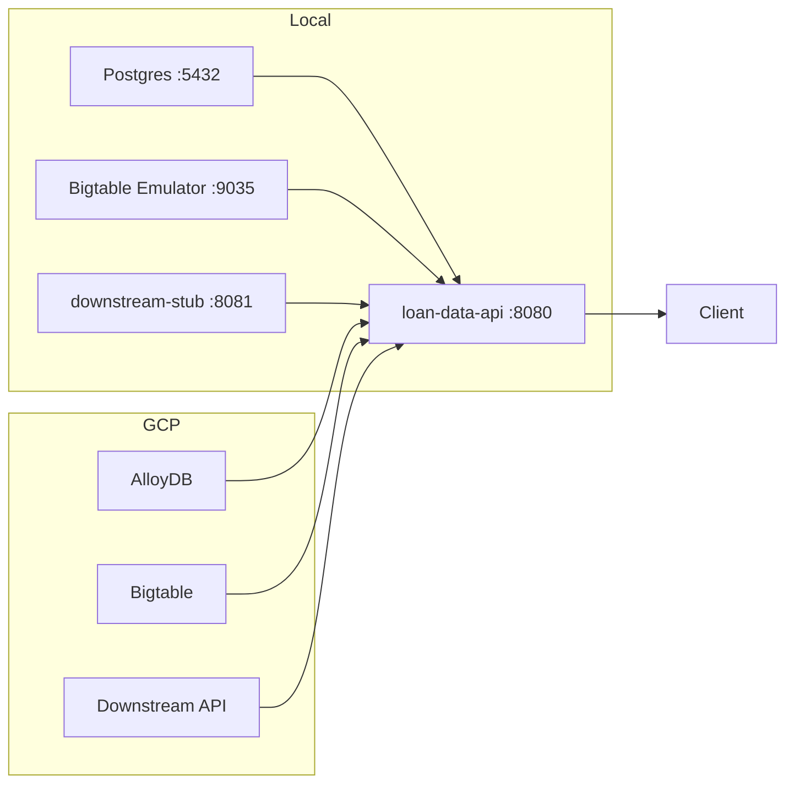

# Loan Data API — POC

> Production-reference Spring Boot service that reads customer loan data from AlloyDB, Bigtable, and a downstream REST API.

## Architecture



## Prerequisites

- Java 17 (JDK — set `JAVA_HOME`)
- IntelliJ IDEA (enable annotation processing: Settings → Build → Compiler → Annotation Processors → ✓ Enable)
- PostgreSQL 15+ running locally
- Google Cloud CLI — install then: `gcloud components install beta bigtable`

## One-time local setup

```powershell
# Start PostgreSQL service (adjust service name if different)
Start-Service -Name postgresql*

# Create database and user (replace path with your PostgreSQL bin dir)
& "C:\Program Files\PostgreSQL\15\bin\psql.exe" -U postgres -c "CREATE USER loanuser WITH PASSWORD 'loanpass';"
& "C:\Program Files\PostgreSQL\15\bin\psql.exe" -U postgres -c "CREATE DATABASE loandb OWNER loanuser;"
```

## Daily local run

```powershell
# Terminal 1 — start everything
.\scripts\seed-local.ps1

# Terminal 2 — downstream stub
$env:SPRING_PROFILES_ACTIVE='local'; .\gradlew.bat :downstream-stub:bootRun

# Terminal 3 — main service
$env:SPRING_PROFILES_ACTIVE='local'; .\gradlew.bat :loan-data-api:bootRun
```

Then open: http://localhost:8080/swagger-ui.html

## Sample requests

| Endpoint | Example | Expected |
|---|---|---|
| GET loan | `GET /api/v1/loans/LN1000000001` | 200 loan detail |
| GET loan — not found | `GET /api/v1/loans/LN9999999999` | 404 ProblemDetail |
| GET loan — bad format | `GET /api/v1/loans/BAD` | 400 ProblemDetail |
| GET relationship accounts | `GET /api/v1/customers/1/relationship-accounts` | 200 paged list |
| GET payments | `GET /api/v1/loans/LN1000000001/payments` | 200 payments list |
| POST notes | `POST /api/v1/loans/LN1000000001/notes` | 200 note created |
| POST notes — simulate 500 | `POST /api/v1/loans/LN9999999500/notes` | 502 ProblemDetail |

## GCP setup

| Variable | How to obtain |
|---|---|
| `ALLOYDB_INSTANCE_URI` | `gcloud alloydb instances describe <instance> --cluster=<cluster> --region=<region> --format='value(name)'` |
| `ALLOYDB_DB_NAME` | Database name (e.g. `loandb`) |
| `ALLOYDB_IAM_USER` | Service account email used by Cloud Run |
| `ALLOYDB_IP_TYPE` | `PRIVATE` (default) or `PUBLIC` |
| `BIGTABLE_PROJECT_ID` | `gcloud config get-value project` |
| `BIGTABLE_INSTANCE_ID` | `gcloud bigtable instances list` |
| `BIGTABLE_APP_PROFILE_ID` | `default` or your custom profile |
| `DOWNSTREAM_BASE_URL` | Base URL of the downstream REST service |
| `OAUTH2_ISSUER_URI` | `https://accounts.google.com` (for GCP) |
| `OAUTH2_AUDIENCE` | Your API Gateway audience or client ID |

```powershell
# Authenticate
gcloud auth application-default login
$env:SPRING_PROFILES_ACTIVE='gcp'; .\gradlew.bat :loan-data-api:bootRun
```

Required IAM roles on the Cloud Run service account:
- `roles/alloydb.client`
- `roles/bigtable.reader`
- `roles/iam.serviceAccountTokenCreator` (for AlloyDB IAM auth)

## Cloud Run + API Gateway deployment

See `deploy/README.md` and `gateway/README.md` for deployment documentation.
These belong in the infrastructure repository in the target architecture.

## Troubleshooting

| Symptom | Fix |
|---|---|
| `Connection refused :5432` | Start PostgreSQL: `Start-Service postgresql*` |
| `Connection refused :9035` | Run `.\scripts\seed-local.ps1` to start the emulator |
| `Connection refused :8081` | Start downstream-stub in a separate terminal |
| `401 Unauthorized` in gcp | Check `OAUTH2_ISSUER_URI` and `OAUTH2_AUDIENCE` env vars |
| `HikariPool timeout` | Verify `loanuser` can connect: `psql -U loanuser -d loandb` |
| Lombok not generating code | Enable annotation processing in IntelliJ |

## Project structure

```
loan-data-api/          — deployable Spring Boot service (Cloud Run)
  src/main/java/.../
    config/             — Spring configuration beans
    controller/         — REST controllers (HTTP + OpenAPI only)
    service/            — business logic and orchestration
    repository/alloydb/ — JPA repositories
    repository/bigtable/— Bigtable read-only access
    client/             — downstream REST HTTP client
    model/dto/          — API request/response records
    model/entity/       — JPA entities
    mapper/             — DTO ↔ entity conversion
    exception/          — exception types + @RestControllerAdvice
    observability/      — correlation ID filter, log masking
    security/           — Spring Security configuration
downstream-stub/        — LOCAL ONLY: imitates the downstream API on :8081
gateway/                — API Gateway OpenAPI config (infrastructure repo)
deploy/                 — Cloud Run deploy docs (infrastructure repo)
scripts/                — local development helpers
```

## Build

```powershell
# Lint + tests + 80% coverage gate
.\gradlew.bat :loan-data-api:check

# Format
.\gradlew.bat :loan-data-api:spotlessApply
```
